# ucweb

A web remote for [Unfolded Circle](https://www.unfoldedcircle.com/) Remote 3 and Remote Two. Open it on a phone
or in a desktop browser to start and stop activities, use your activity pages and the remote's own pages, switch
lights and set thermostats, drive the D-pad, volume and transport buttons, play from your music library, browse
every entity and integration, and watch every remote's status live.

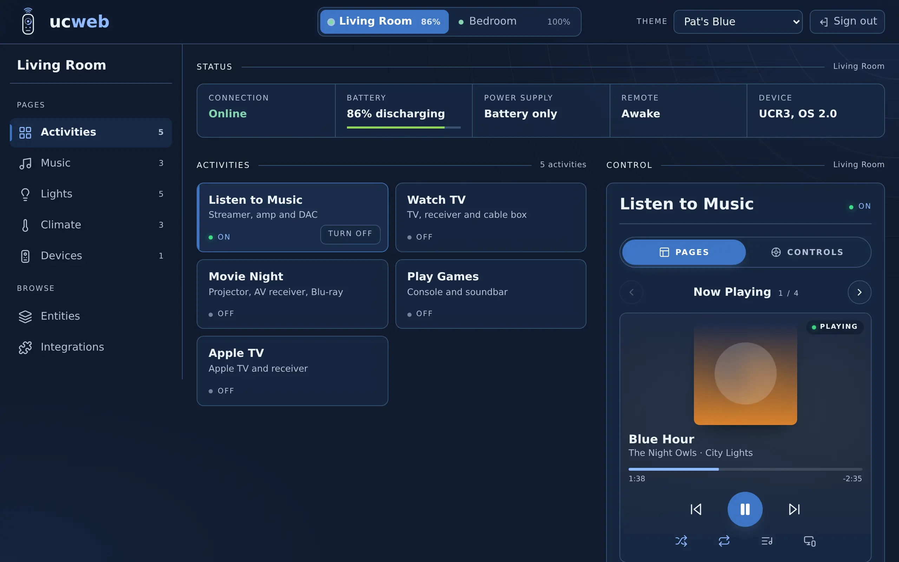

<p align="center">
  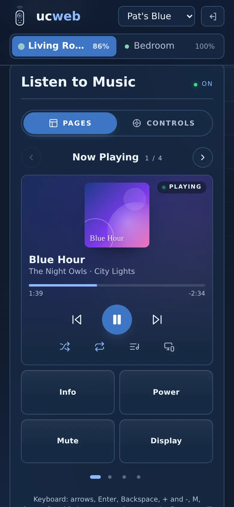
  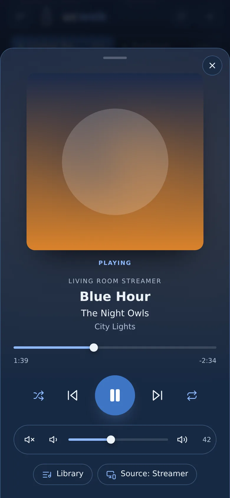
  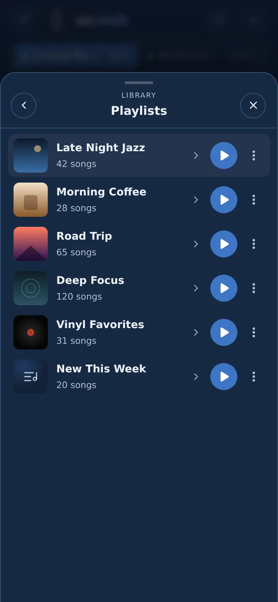
</p>

The screenshots use made-up remotes, activities and music.

## Features

- **Menu**: the remote's own pages (the ones on its home screen, in the same order), then Entities and
  Integrations. On a wide screen the menu stays open beside the page; on a phone or tablet the menu button opens it.
- **Activities**: every activity on each remote, with its live state (on, off, working, error). Tap to start,
  tap again to control, one tap to turn off.
- **Remote pages**: each page from the remote's home screen, such as Music, Lights, Thermostats or Cameras, with every
  entity on it as a live tile: switch lights and set their brightness, flip switches, set a thermostat's target and
  mode, open, stop and position blinds, press buttons, run macros, read sensors, pick an option, play and pause
  players (tap one for the full player), and start activities. Groups show as a titled block. Each tile offers only
  what that entity reports it supports.
- **Devices**: a remote device with its own pages or button mapping (an AV receiver, an IR device) opens in the
  Control panel like an activity, with its pages and the control pad sending that device's own commands.
- **Entities**: every entity on the remote in one searchable list, filtered by type, with the same live tiles.
- **Integrations**: every integration set up on the remote with its version, developer and live connection state,
  plus the installed drivers that have no device set up. Read only; setup data and tokens never leave the server.
- **Control pad**: D-pad and OK, back, home, menu, volume, mute, channel, play/pause, previous, next, stop and
  record. Each button sends exactly what the activity's own button mapping sends; buttons the activity does not
  use are dimmed, and buttons it does not have are hidden. Hold volume, channel or an arrow to repeat. A button
  with a long press in its mapping (marked with a small dot) sends that when held for half a second, and its normal
  press when let go sooner. On a
  desktop the keyboard works too: arrows, Enter, Backspace, + and -, M and Space. On a phone that can vibrate,
  every press gives a short buzz.
- **Activity pages**: the pages you built for each activity in the web configurator, laid out on the same grid.
  Swipe, use the arrows or dots, or press `[` and `]` to slide between them; the home button beside the page name (or
  `0`) slides back to the first page. A Pages | Controls switch (or `T` on a
  keyboard) flips between the pages and the control pad, and each browser remembers which one you use. The keyboard
  shortcuts for the pad work in both views. Buttons send exactly the command the
  page stores. Media widgets show artwork, title, artist and live progress, and sensor and select widgets show their
  current value, all updated live. ucweb draws every icon itself in the current theme, picked from what the button
  does (the input it selects, the app it opens, the command it sends), so a page looks the same in every theme.
  Apps are shown by name, never by logo. The last page you looked at is remembered for each activity.
- **Media widgets** carry their own controls like the remote app: previous, play and pause, next, shuffle, repeat and
  a source picker, each shown only when the player supports it.
- **Library**: the library button on a media widget (or in the full player) browses the player's own library, such as
  Spotify playlists or Roon's Library, Radio and TIDAL, with artwork and paging. Tap a folder to open it, tap play to
  play it, and use the menu for Play next or Add to queue when the player offers them. ucweb only plays items the
  player just listed.
- **Player**: tap a media widget's artwork for the full player: large artwork, title, artist and album, a seek bar, play and
  pause, previous, next, stop, shuffle, repeat, volume and source. It offers only the controls that player reports it
  supports, and the server checks every command against that list before sending it.
- **Rooms**: the remote's activity groups (one per room, as set up in the web configurator) under the status,
  each showing what is running in it, with one **Turn off** for the whole room.
- **Live status**: connection, battery level and charging, power supply, power mode (awake, idle, low power,
  asleep) and the device's model and firmware, updated as they change. When the battery cannot be read right now,
  or the remote is offline, the last reading is shown dimmed with its age ("Last read 4 min ago") instead of n/a.
- **Several remotes**: switch between them at the top of the page.
- **PIN sign-in**: one PIN for the whole app, kept as a scrypt hash. A browser stays signed in for 30 days.
- **Themes**: Miyara (the default), Pat's Blue, Original, Obsidian & Copper, Roon Dark, Roon Light, Dark Orange,
  Graphite & Brass, Brookwood and Brookwood Light. Each browser keeps its own choice.

ucweb only controls. It never changes a remote's configuration: use the remote's web configurator for that.
Select widgets on activity pages show their current option but can't change it (select tiles on the remote's
pages can), and numpad items are not drawn: no page on the remotes this was built against uses either. Lights
offer on, off and brightness, not color or color temperature.

## How it works

A small Node server holds one API key per remote, keeps a live WebSocket connection to each remote's Core API,
and serves the web app. The browser talks only to ucweb, never to the remotes, so the keys never leave the
server. The server sends only these kinds of command: start or stop an activity, press a button that the activity
or remote device maps, press an item on one of their pages, drive a media player (only the controls it reports),
control a light, switch, thermostat, cover, button, macro, select or remote device within what it reports it
supports, and reboot or power off the remote. It looks the command up itself, so a browser can only name a button,
a page item or one of those actions, never send an arbitrary command to your devices. Integration listings carry
only names, versions and states: setup data, such as a Home Assistant token, is dropped on the server. Album art is fetched by the server from the address
the player reports, without the API key, and only image types are passed on.

## Install

You need:

- One or more Unfolded Circle remotes on your network, and each one's **web-configurator PIN**: the PIN you use to
  sign in to the remote's web configurator.
- A machine that runs Docker on the same network as the remotes: Unraid, a NAS, a Raspberry Pi, any Linux box.

Give each remote a fixed IP address in your router first, so ucweb can always find it.

### 1. Run the container

Start ucweb with your remotes' addresses and a folder for its settings and keys as `/config`:

```sh
docker run -d --name ucweb --init --restart unless-stopped \
  -p 8080:8080 \
  -v /path/to/ucweb:/config \
  -e UC_REMOTES=192.168.1.20,192.168.1.21 \
  ghcr.io/guyp2k/ucweb:latest
```

Or with Compose:

```yaml
services:
  ucweb:
    image: ghcr.io/guyp2k/ucweb:latest
    init: true
    restart: unless-stopped
    ports:
      - "8080:8080"
    volumes:
      - /path/to/ucweb:/config
    environment:
      UC_REMOTES: 192.168.1.20,192.168.1.21
```

Until step 2 is done, the log says `No API key for ...` for each remote. That is expected.

#### On Unraid, step by step

1. Install the template. In a terminal on the server (the `>_` button at the top of the web UI):

   ```sh
   wget -O /boot/config/plugins/dockerMan/templates-user/my-ucweb.xml \
     https://raw.githubusercontent.com/guyp2k/ucweb/main/unraid/ucweb.xml
   ```

2. Open **Docker**, then **Add Container**, and pick **ucweb** under *User templates*.
3. Fill in **Remotes** with your remotes' IP addresses, comma separated. Leave **Config** at
   `/mnt/user/appdata/ucweb`.
4. Choose the network. **Bridge** serves ucweb on the server's IP at the **Web UI port** (8080). A custom network
   such as `br0` gives ucweb its own IP address, served on port 8080. Either works; the custom network keeps port
   8080 free on the server.
5. Optional, under *Show more settings*: the **Default theme** for browsers that have not picked one. PUID 99 and
   PGID 100 are Unraid's defaults; keep them.
6. **Apply**.

### 2. Create an API key on each remote

```sh
docker exec -it ucweb npm run create-key
```

```text
Web-configurator PIN for Living Room (192.168.1.20):
Created the ucweb key for Living Room and stored it in /config/keys/Remote3-a1b2c3.key.
The key in /config/keys/Remote3-a1b2c3.key works on Living Room (192.168.1.20).
Web-configurator PIN for Bedroom (192.168.1.21):
...
ucweb picks the keys up on its own within 30 seconds; no restart needed.
```

It goes through every remote in `UC_REMOTES`, asks for that remote's web-configurator PIN (it is not saved),
creates an API key named `ucweb` and saves it as `/config/keys/<remote hostname>.key`. Remotes whose key already
works are skipped. ucweb connects to each remote on its own as soon as its key is there: the log shows
`connected to <remote name>`. On Unraid you can also click the ucweb icon on the Docker page, choose **Console**,
and run `npm run create-key`.

- `npm run create-key -- 192.168.1.20` does one remote.
- `npm run create-key -- --check` tests the stored keys without changing anything.
- `npm run create-key -- --replace` revokes the old `ucweb` key and issues a new one, for example after a remote
  was reset.

The key has admin scope on that remote: treat the files like passwords.

### 3. Set the PIN

ucweb asks for its own PIN before anyone can use it. Set it once:

```sh
docker exec -it ucweb npm run set-pin
```

On Unraid you can also click the ucweb icon on the Docker page, choose **Console**, and run `npm run set-pin`.

Then open `http://<server>:8080/` (or the container's own IP on a custom network) and sign in:

<p align="center">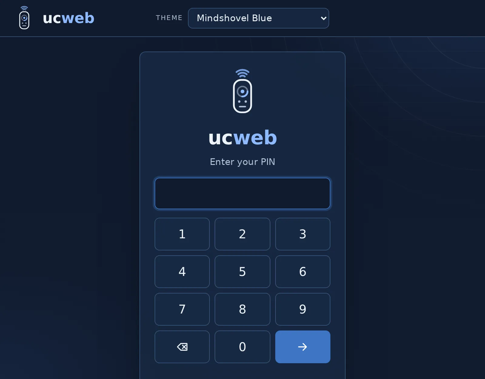</p>

Run `set-pin` again any time to change the PIN; that signs every browser out. Add the page to your phone's home
screen and it opens full screen like an app.

## Using ucweb

**Menu.** The menu lists the remote's pages in the order the remote shows them, with the number of items on each,
then **Entities** and **Integrations**. Each browser remembers the last screen per remote. On a desktop the menu
stays open on the left; on a phone, tap the menu button at the top left and it slides in.

<p align="center">
  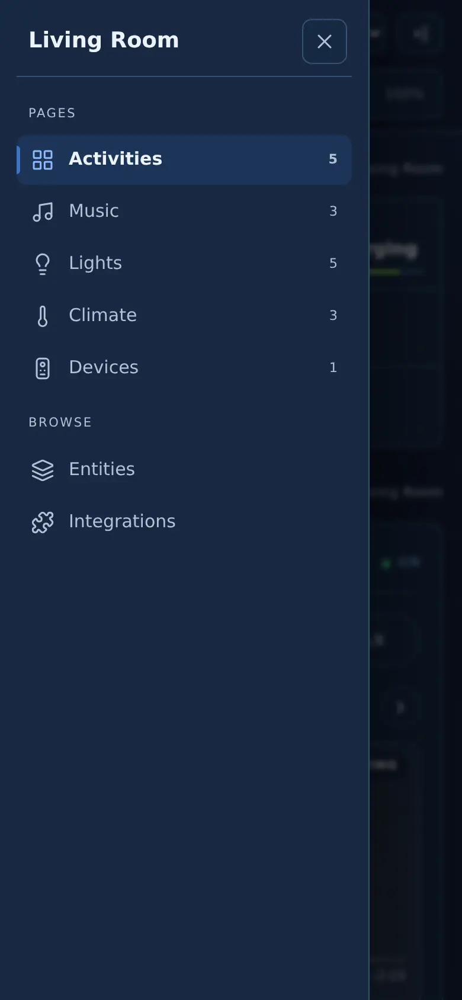
  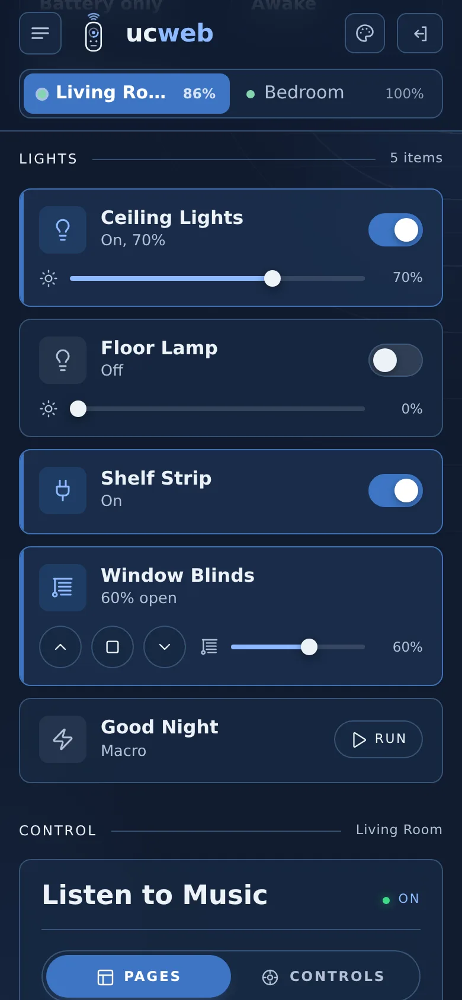
  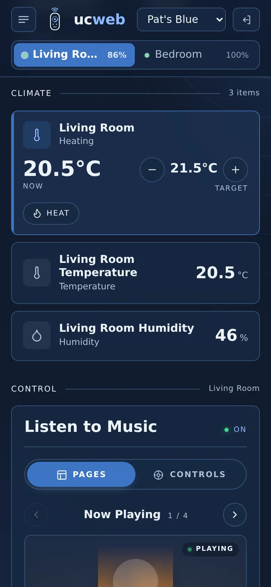
</p>

**Remote pages.** A light shows a switch and, if it dims, a brightness slider. A thermostat shows the current
temperature, steps the target with minus and plus (sent once you stop tapping) and picks its mode from the modes it
supports. Blinds open, stop, close and move to a position. A player tile shows what is playing with its controls;
tap it for the full player. A remote device with its own pages shows **Open controls**: tap it to drive that device
in the Control panel, and the close button there hands the panel back to the running activity.

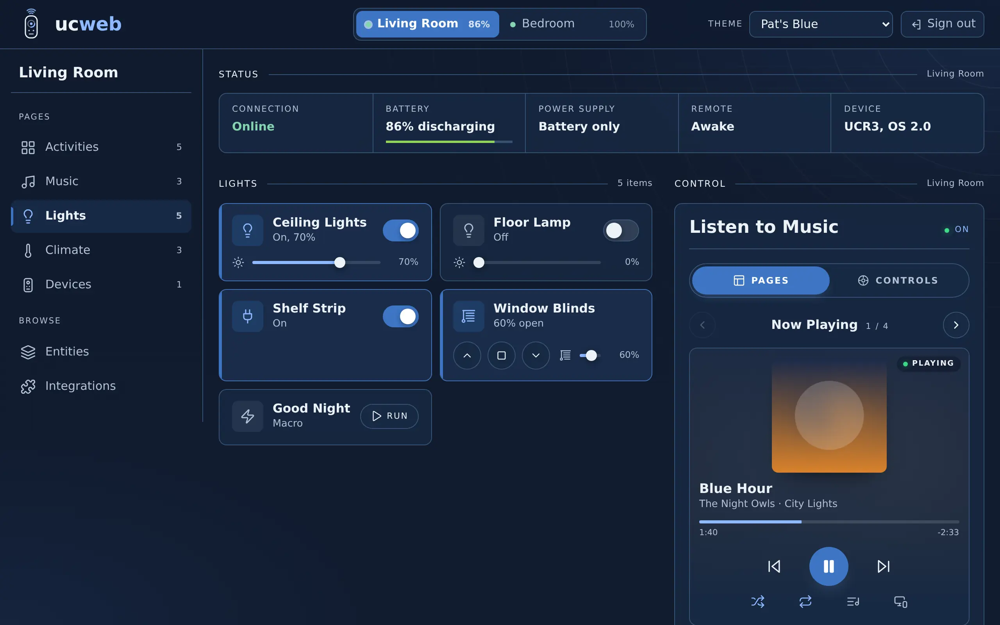

**Activities.** Every activity on the selected remote, with its live state. Tap one that is off to start it, tap a
running one to control it, and use **Turn off** to stop it. Switch remotes with the tabs at the top; each tab shows
that remote's battery.

**Rooms.** If the remote has activity groups besides its Default group, each one appears under Status with what is
running in it (or Off, or that the last run failed). **Turn off** stops every activity in that room that is on or
starting. Groups are read when ucweb connects, when the remote wakes and when an activity is added, renamed or
deleted. The remote sends no event when a group is edited, so a group change made in the web configurator shows up
at the next of those, or when the ucweb container restarts.

**Pages and controls.** A running activity shows its pages, laid out on the grid you built in the web configurator,
or the control pad. The **Pages | Controls** switch flips between them (`T` on a keyboard). Swipe, use the arrows
or dots, or press `[` and `]` to change page; the house button beside the page name (or `0`) goes back to the first
page. ucweb remembers the last page per activity.

<p align="center">
  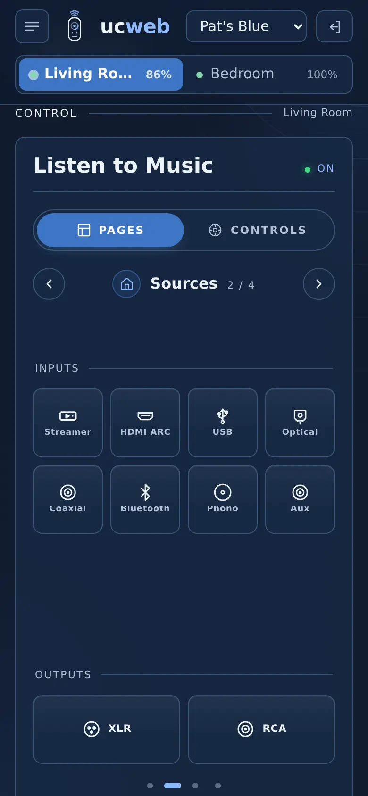
  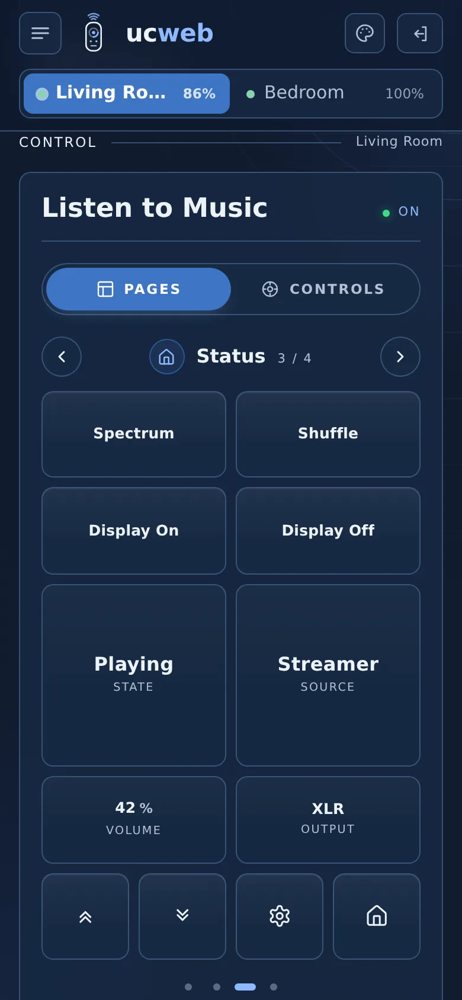
  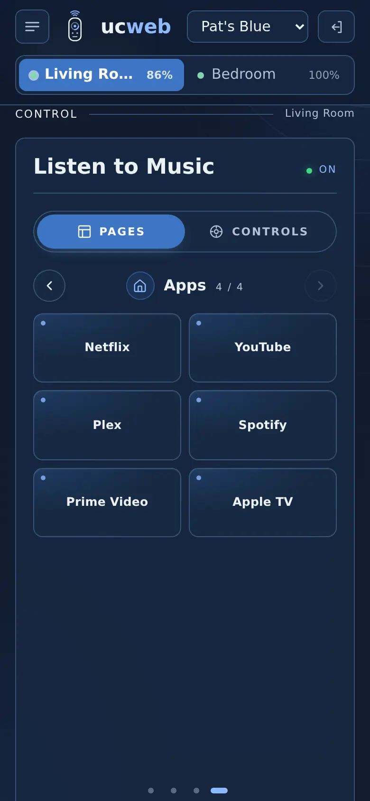
  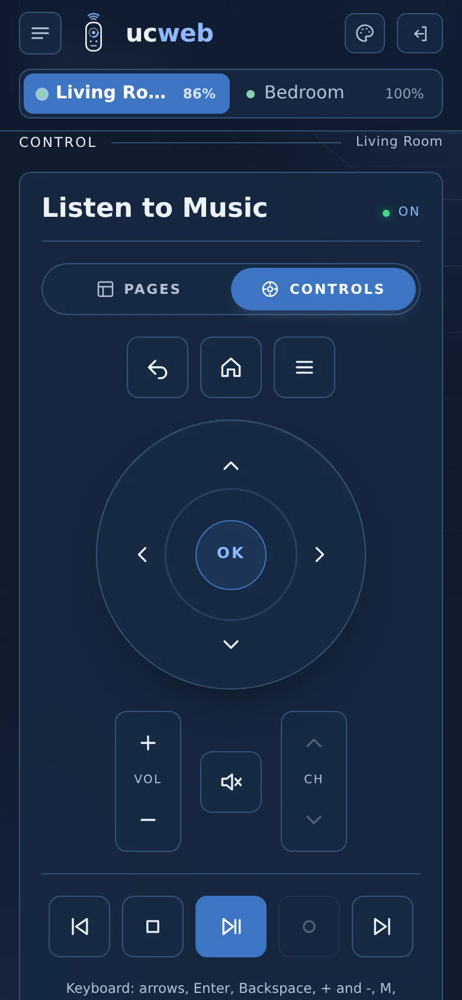
</p>

**Icons.** ucweb draws every icon itself, in the current theme, from what the button does: the input it selects
(HDMI, USB, optical, RCA, XLR, Bluetooth...), the command it sends (home, back, menu, settings) or the app it opens.
Apps appear by name. Icon images uploaded to the remote are not shown, so pages look consistent in every theme.

**Media.** A media widget shows artwork, title, artist and live progress, with previous, play and pause, next,
shuffle, repeat, the library and the source picker underneath, each only when that player supports it. Tap the
artwork for the full player, with seek and volume. The library button browses the player's own library (playlists,
albums, radio) and plays or queues what you pick. The source button picks the player's input or output; for Spotify
that is the list of Spotify Connect devices.

<p align="center">
  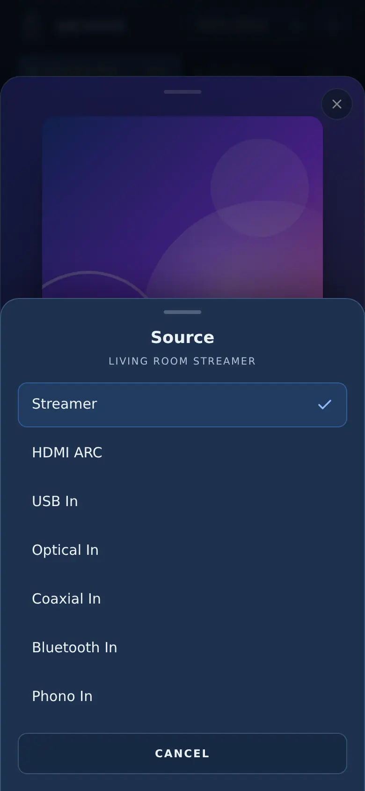
</p>

**Keyboard** (desktop):

| Key | Does |
|---|---|
| Arrows, Enter | D-pad and OK (hold a key for half a second for a button's long press) |
| Backspace or Escape | Back |
| Home | Home |
| `+` `-` | Volume up and down |
| `M` | Mute |
| Space | Play or pause |
| Page Up, Page Down | Channel up and down |
| `[` `]` | Previous and next page |
| `0` | First page |
| `T` | Switch between pages and controls |

**Entities and integrations.** Entities lists everything on the remote; type in the search box or pick a type to
narrow it, and use the tiles as on any page. Integrations shows each one's state (connected, connecting,
disconnected, error) as it changes.

<p align="center">
  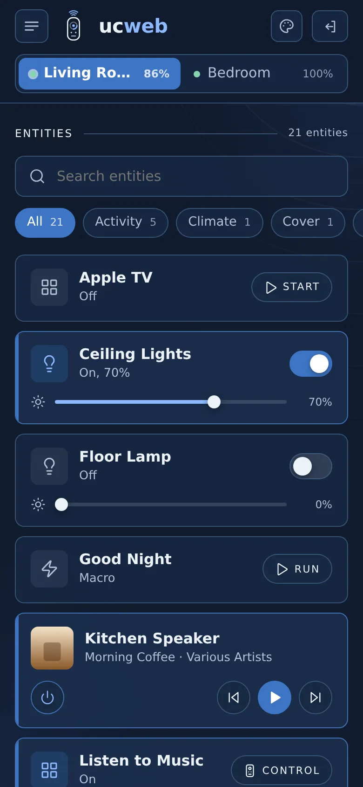
  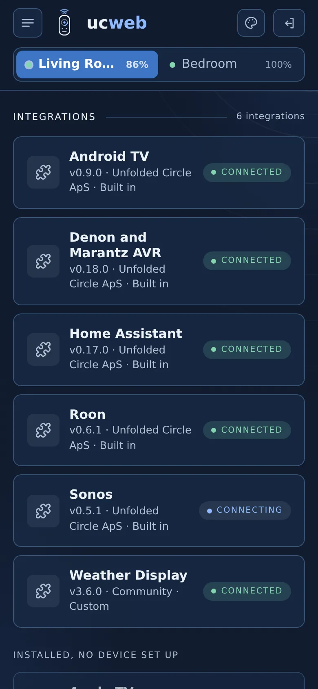
</p>

**Remote panel.** At the bottom of the page: open the remote's own web configurator, reboot the remote, or power
it off. Reboot and power off ask you to tap twice.

**On your phone's home screen.** On an iPhone, open ucweb in Safari, tap Share, then **Add to Home Screen**: it
opens full screen with its own icon. On Android, use Chrome's menu, **Add to Home screen** (or **Install app**).
Served over plain `http://` (the usual LAN setup), Android adds a shortcut rather than a full app install.

If ucweb is served over HTTPS (for example behind a reverse proxy with a certificate), it also installs as a full
app on Android and opens even when the server can't be reached: the page loads from the phone and says it is
trying to reach ucweb until it can. Browsers only allow this offline start on HTTPS. Commands, states and
everything else from the remotes are never saved on the phone; ucweb needs the server for those.

**Themes.** Pick one from the menu at the top. Each browser keeps its own choice.

**Vibration.** On a phone whose browser can vibrate (Chrome and most Android browsers; iPhones cannot), every
button press gives a 10 ms buzz; held buttons buzz once, not on every repeat. **Vibrate on press** in the menu
turns it off for that browser. Browsers that cannot vibrate, and computers without a touch screen, do not show it.

<p align="center">
  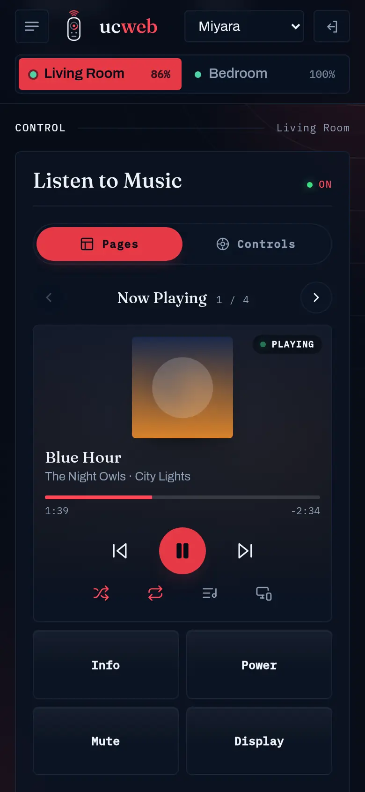
  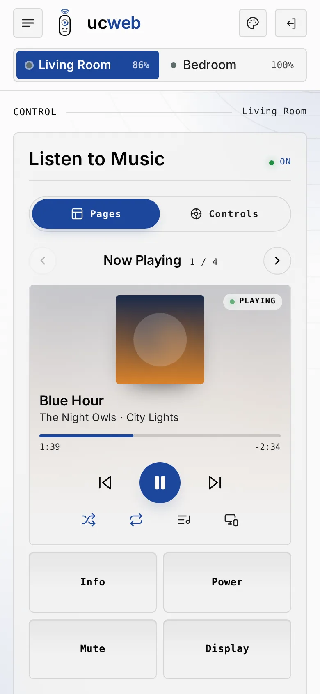
  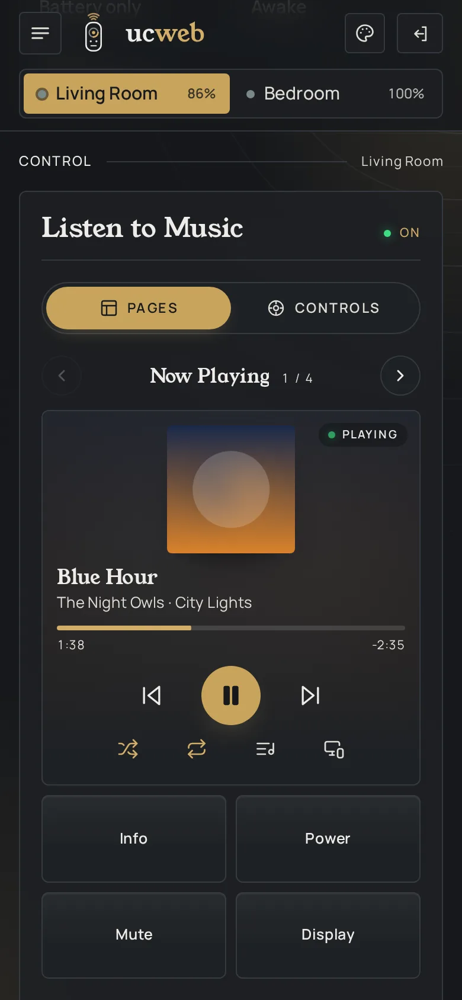
</p>

## Updating

Pull the new image and recreate the container (`docker compose pull && docker compose up -d`, or on Unraid
**Check for Updates**, then **Apply update**). Open browsers notice the new version and reload themselves. Your
keys, PIN and sign-ins are kept in `/config`.

## Troubleshooting

| What you see | What to do |
|---|---|
| A remote shows **Offline** with "No API key for ... expected /config/keys/....key" | Run `docker exec -it ucweb npm run create-key`. A key copied in by hand must be named after the remote's hostname, exactly as the message shows. |
| "The API key was rejected" | The key was deleted on the remote or the remote was reset. Run `docker exec -it ucweb npm run create-key -- --replace`. |
| "... did not answer" | Check the IP in `UC_REMOTES` and that the server can reach the remote (same network or a firewall rule between VLANs). A remote that is asleep off its dock drops off Wi-Fi; ucweb reconnects on its own when it wakes. |
| The status bar says **Low power** | Normal. A docked remote dozes with its screen off but stays connected and controllable. |
| Battery says **Not readable**, or shows a dimmed level with **Last read ... ago** | Some firmware answers battery requests with an error while docked in low power. ucweb shows the last level it read (until the container restarts), asks again every minute and goes back to the live level as soon as an answer comes. In testing, shortening the remote's sleep timeout from 10 to 5 minutes made it go away. |
| "No PIN is set yet" | Run `docker exec -it ucweb npm run set-pin`, then reload the page. |
| Sign-in is refused even with the right PIN | Too many wrong PINs: a browser waits 30 seconds after five misses, doubling up to 15 minutes, and 30 misses in 15 minutes lock sign-in for everyone until the window passes. |
| A pad button is dimmed | That button is not mapped in the activity. Map it in the web configurator under the activity's button mapping. |
| A widget says **Player not available** or **Unavailable** | The page points at a device the remote no longer has, or its integration is offline. Fix the page or the integration in the web configurator. |
| A library list says it has items but shows none | The player listed the folder but sent no items. Spotify does this for some playlists; ucweb says so instead of loading forever. |
| The page looks out of date after an update | Reload once. ucweb reloads by itself on new versions, but a page left open across a restart may need a nudge. |

## Settings

| Variable | Default | Meaning |
|---|---|---|
| `UC_REMOTES` | (required) | Remote addresses, comma separated. A port is allowed (`192.168.1.20:8080`). |
| `UCWEB_CONFIG_DIR` | `/config` | Holds `keys/`, `pin.hash` and `session.secret`. |
| `UC_KEYS_DIR` | `$UCWEB_CONFIG_DIR/keys` | Where the `<hostname>.key` files are. |
| `PORT` | `8080` | Port the web app listens on. |
| `UCWEB_THEME` | `miyara` | Theme for browsers that have not picked one: `miyara`, `pats-blue`, `original`, `copper`, `roon`, `roon-light`, `dark-orange`, `graphite-brass`, `brookwood` or `brookwood-light`. |
| `PUID` / `PGID` | `1000` | Owner of the config folder. The container fixes the folder's ownership at start and then drops root. Unraid uses 99 and 100. |

## Security

- Keep ucweb on your LAN. Never forward its port to the internet: the API keys it holds have admin scope on
  your remotes.
- Wrong PINs are throttled: after five misses a browser's address waits 30 seconds, doubling up to 15 minutes,
  and 30 misses in 15 minutes from anywhere lock sign-in for everyone until the window passes.
- The session cookie is `HttpOnly` and `SameSite=Strict`, commands must come from the app's own page, and every
  response carries a strict Content Security Policy.

## Development

```sh
npm install
npm test        # node:test, against a fake remote that speaks the Core API's REST and WebSocket
npm run lint
UC_REMOTES=192.168.1.20 UCWEB_CONFIG_DIR=./dev npm start
```

Node 20 or later. The browser code is plain ES modules with no build step. The home screen icons in
`public/icons` are made from `public/favicon.svg` by `scripts/build-icons.sh` (needs ImageMagick); run it again
after changing the logo.

### Against the Unfolded Circle core simulator

`npm run test:sim` runs ucweb against the real Core API in
[unfoldedcircle/core-simulator](https://github.com/unfoldedcircle/core-simulator): it creates an API key and two
activities, then starts, presses, renames and deletes through ucweb and checks the live events. CI runs it on every
push before the image is built.

```sh
docker run -d --name core-simulator -p 8080:8080 unfoldedcircle/core-simulator:0.81.2-bt
UC_SIM=127.0.0.1:8080 npm run test:sim
```

The last test sends REBOOT, which stops the simulator; start it again for the next run. `UC_SIM_USER` and
`UC_SIM_PASSWORD` default to the simulator's `web-configurator` / `1234`. The simulator is licensed for development
use only and is never part of the ucweb image.

## Credits

- The Remote's API is documented in [unfoldedcircle/core-api](https://github.com/unfoldedcircle/core-api).
- The Original, Obsidian & Copper, Roon Dark, Roon Light, Dark Orange, Graphite & Brass and Miyara themes
  follow the themes of [Rabbit Hole Fork](https://github.com/guyp2k/RabbitHole-Fork). Graphite & Brass follows
  [Rouen](https://github.com/meltface-80/Rouen).
- Fonts are under the SIL Open Font License; each theme's `fonts/LICENSE.txt` lists them.
- Most page icons follow the geometry of [Lucide](https://lucide.dev) (ISC License); the connector icons are drawn
  for ucweb. See `public/icons.LICENSE.txt`.

ucweb is an independent project and is not affiliated with or endorsed by Unfolded Circle.

## License

MIT
